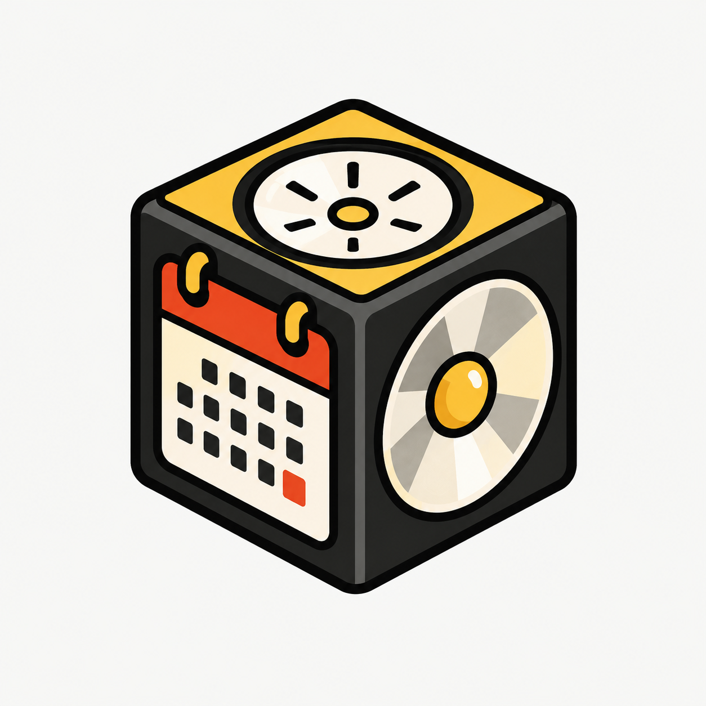

  

<h1 align="center">Log365</h1>

  Design bento grids and monthly photo calendars in your browser. 
  Drag, resize and style cards, preview day and night, then export a PNG, a web page or a React component.

  One HTML file · no build step · no dependencies · nothing leaves your device

    

---

## What it does

Log365 is a visual editor for two kinds of layouts:

- **Photo calendars.** Pick a month, and the days lay out automatically with weeks starting on Monday. Put a photo on every day.
- - **Bento grids.** Tiles of any size on a grid you define, for portfolios, link-in-bio pages, product launches, dashboards and photo walls.

Everything runs locally in the page. There is no account, no server and no analytics.

## Features

### Grid and cards

- Grid of 1 to 24 columns and rows, with ratio presets (16:9, 3:2, 4:3, 1:1, 4:5, 9:16, 2:1) or a custom ratio
- Click the pixel size under the board to set the exact canvas size (64 to 8000 px per side), with an optional locked ratio
- Cards span any number of cells. Drag the eight handles to resize, drag the card to move it. Dropping onto a neighbour swaps them when both still fit
- Undo and redo (100 steps), duplicate, keyboard nudging, and optional guides for empty cells
- Fills: solid, gradient with angle, outline, or photo with adjustable dimming
- Content: heading, body text, a big number, a link button, and 21 icons
- Text: alignment, size, automatic or custom color, and sideways text
- 4 typefaces (Bricolage Grotesque, Instrument Sans, Fraunces, JetBrains Mono) and 7 palettes that recolor the whole board

### Photo calendar

- Month and year picker with previous, next and "this month"
- Monday-first weeks. The grid grows or shrinks to 4, 5 or 6 weeks
- Choose a photo for one day (select it, or double-click it), add many photos at once to fill the empty days in order, or use one photo for every empty day
- Day numbers in white or black on photos. Days without a photo pick a readable color on their own
- Photos stay attached to their dates when you switch months and come back

### Day and night

- Sun and moon toggle in the editor, following your system setting by default
- Preview the board in night colors before exporting. Night colors are derived automatically from your day colors
- Exported pages and React components can include their own day and night toggle that starts from the visitor's system setting and remembers the choice

### Templates

Portfolio, Photo calendar, Link in bio, Product launch, Metrics board, Photo grid, and a Blank board. You can also save your own layouts in the browser.

### Export and share

| Format | What you get |
| --- | --- |
| **PNG** | Rendered at exactly the canvas size you set, in day or night colors |
| **HTML + CSS** | A complete page. Sizes use container query units, so the board scales with its width. Photos are embedded |
| **React** | One component with inline styles. Photos become `/images/card-N.jpg` placeholders to replace with your own files |
| **JSON** | The full layout, importable again |
| **Share code** | A compact text code you can paste to someone else. Photos are included |

## Quick start

1. Download `index.html`.
2. Open it in a current version of Chrome, Edge, Safari or Firefox.

That is all. There is no `npm install`, no server and no Python.

Log365 is developed and tested in Chromium. Fonts load from Google Fonts, so they need a connection the first time. Without one, the editor falls back to system fonts.

## Keyboard shortcuts

| Key | Action |
| --- | --- |
| Click, Tab | Select a card |
| Drag | Move a card |
| Drag a handle | Resize a card to any span |
| Arrow keys | Move the selected card |
| Shift + arrow keys | Resize the selected card |
| Ctrl/⌘ + Z | Undo |
| Ctrl/⌘ + Shift + Z | Redo |
| Ctrl/⌘ + D | Duplicate |
| Delete | Delete the selected card |
| N | Add a 1×1 card |
| G | Show or hide cell guides |
| Esc | Deselect |
| Double-click a calendar day | Choose its photo |
| ? | Show this list in the app |

## How the exports work

- **HTML and React** use CSS container query units (`cqw`), so one board scales cleanly from a phone to a wide screen. The maximum width is the pixel size you set.
- **Day and night** in exports use CSS custom properties switched by a `data-mode` attribute. A short script sets the mode from the visitor's system setting and a saved choice.
- **Photos** are resized in your browser (640 px on calendar days, 1400 px elsewhere) and stored as data URIs. They are never uploaded anywhere.

## Privacy

Log365 makes no network requests except loading fonts from Google Fonts. Your current board, saved layouts and theme choice are kept in your browser's local storage on your device. Clearing site data removes them, so export a JSON file or share code for anything you want to keep.

## Known limits

- Browsers allow about 5 MB of local storage. A calendar with many large photos may not autosave. The page tells you when saving fails.
- Share codes and HTML exports grow with the number of photos.
- Very large canvases can fail to render a PNG, especially on phones, because browsers cap canvas size.
- Switching the calendar to another month rebuilds its layout. Photos, background, spacing and typeface are kept, but manual edits to individual day cards are reset.
- Weeks start on Monday. There is no setting for Sunday-first yet.

## Roadmap ideas

- Custom night colors per card
- Sunday-first option for calendars
- More calendar layouts, such as a week view
- Drag a photo from your computer straight onto a day

## Contributing

Issues and pull requests are welcome. Please open an issue first for larger changes. Keep the project dependency-free and in a single file.

## License

MIT. See `LICENSE`.
